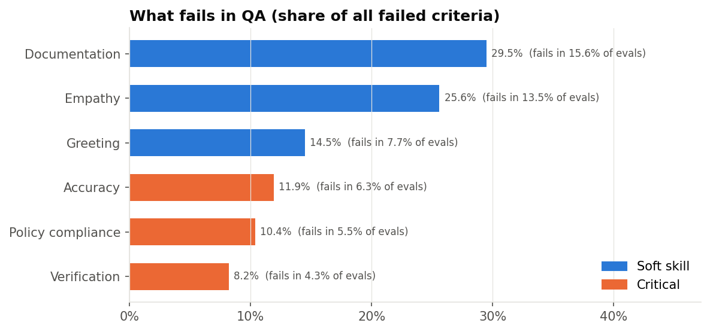
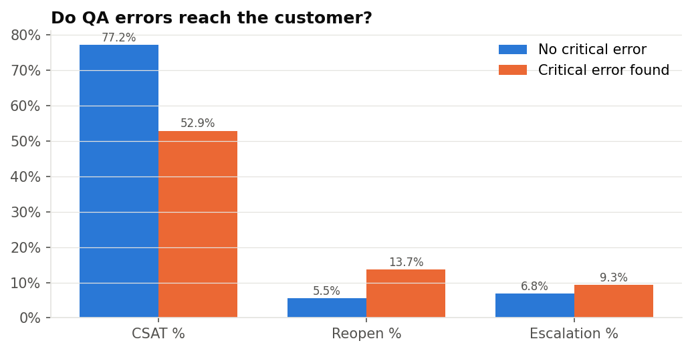
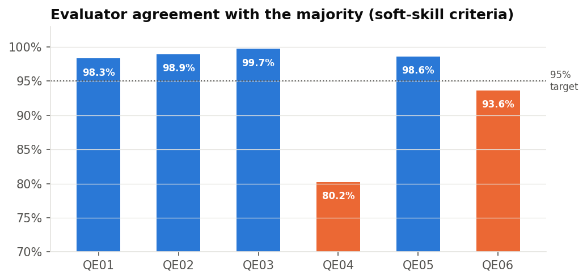

# Support Quality Analytics: QA, SLA & CSAT

[](https://github.com/nabeel1199/support-quality-analytics/actions/workflows/ci.yml)

Analytics for a customer-support operation (80 agents, 63,180 tickets, 7,304 QA evaluations over 12 months). It answers the questions a support or quality manager actually asks:

- Are we meeting SLA, and when do we miss it?
- Which QA criteria fail most, and which agents are most at risk?
- Do QA errors actually hurt customers?
- Are the QA evaluators scoring consistently?
- Did the coaching programme work?
- Who needs coaching next?

**Live dashboard:** https://nabeel1199.github.io/support-quality-analytics/

> **This project uses synthetic data.** Real contact-centre data (tickets, customer messages, agent scores) is confidential, so every row here is generated by [`scripts/generate_data.py`](scripts/generate_data.py) with a fixed random seed. It is not taken from, or based on, any real company's data. The generator builds in realistic patterns and some deliberately dirty data, and the analysis has to find them. The **methods** (SQL, checks, calibration, difference-in-differences) are what this project demonstrates, and they work unchanged on real data.



## Key findings

| Question | Finding |
|---|---|
| SLA | 89.3% of tickets were resolved within SLA. Attainment falls to **83.0% in the Dec peak** and **83.6% on Mondays**, the busiest day, compared with 98.6% on Saturdays. Misses follow volume, so this is a staffing issue, not an agent-quality issue. |
| What fails in QA | **70% of failed criteria are soft skills** (documentation 29.5%, empathy 25.6%, greeting 14.5%). Accuracy is the most common critical error (fails in 6.3% of evaluations). |
| Who fails | Agents in their **first 3 months** have a **21.2%** auto-fail rate, vs **14.3%** for agents with 6+ months. |
| Customer impact | Tickets with a critical error are **2.5x as likely to be reopened** (13.7% vs 5.5%), and CSAT drops from **77.2% to 52.9%**. An accuracy error alone takes CSAT from 76.6% to **23.1%**. Verification errors don't affect CSAT at all. Customers can't see them, which is why QA has to. |
| Calibration | **QE04** agrees with the majority on only **80.2%** of soft-skill judgements and scores agents **4 points lower** in live QA. **QE06** is lenient (misses errors, 93.6%). |
| Coaching | Team C's auto-fail rate fell 13.6% → 11.5%, while other teams rose 14.2% → 14.9%. **Difference-in-differences: −2.8 pts auto-fail, +2.0 pts QA score.** The gap is largest in Q3 2026 (8.8% vs 15.9%). |
| Next to coach | 7 agents fall in the bottom 10% of QA scores for Jul–Sep 2026 (each with 26+ evaluations). 3 of them are on Team B. |





## Recommendations

1. **Staff for Mondays and the Nov–Dec peak.** That is where SLA is lost.
2. **Target QA sampling and refreshers at accuracy, and at agents in their first 3 months.**
3. **Recalibrate QE04 and QE06** before their scores are used in performance reviews.
4. **Roll out the Team C coaching programme**, starting with the teams of the flagged agents.
5. **Fix data capture:** missing channels, invalid survey values and impossible timestamps.

## How the analysis works

| Step | File | What it does |
|---|---|---|
| Clean | `sql/01_clean.sql` | Measures and fixes 5 data issues: duplicate rows (316), resolved-before-created timestamps (40), out-of-range CSAT (60), unknown agent IDs (25), missing channel (632). Scores QA evaluations with a weighted rubric (`UNPIVOT` to long format). |
| Operations | `sql/02_operations.sql` | SLA by priority target, resolution time (median, p90), CSAT %, escalation and reopen rates by month, channel, category and weekday. |
| Quality | `sql/03_quality.sql` | Error Pareto, tenure analysis, and a join from QA results to ticket outcomes to test whether QA errors affect customers. |
| Calibration | `sql/04_calibration.sql` | Majority-vote consensus from monthly calibration sessions, agreement % per evaluator, and the direction of disagreement (stricter vs more lenient). |
| Coaching | `sql/05_coaching_and_scorecard.sql` | **Difference-in-differences**: Team C's change vs other teams over the same period, using established agents only so new hires don't distort it. Also a quarterly agent scorecard with a minimum-sample rule (12+ evaluations). |

**QA scoring:** 6 criteria with weights: greeting 10, verification 20, accuracy 25, policy compliance 20, empathy 10, documentation 15. Score = % of points passed. A failed **critical** criterion (verification, accuracy, policy) is counted as an **auto-fail**.

## LLM evaluator (experiment)

**Question:** can an LLM score support tickets against this rubric as well as the QA team, and is it better calibrated than QE04 and QE06?

The experiment uses the 120 calibration tickets, where all six evaluators scored the same tickets and the generator also knows the hidden truth ([`src/llm_evaluator.py`](src/llm_evaluator.py), [`sql/llm/agreement.sql`](sql/llm/agreement.sql)):

1. **Write.** Claude writes a transcript for each ticket in which the agent fails exactly the criteria the truth says were failed, using a fixed policy sheet (delivery times, refund window, identity check, credit cap, escalation rules).
2. **Judge.** A separate, **blind** call scores each transcript against the rubric. The judge sees only the transcript, never the truth or the failure list; a test checks this on every request.
3. **Compare.** The LLM joins the six humans as a seventh rater. Every rater is scored against the **truth** (errors caught, false flags, Cohen's kappa) and against the human majority, reusing the calibration SQL.

**Comparing with the truth already shows something the majority vote hides.** QE06 agrees with the majority on 93.6% of soft-skill judgements, which looks acceptable, but catches only **50% of real soft-skill errors** (23 of 46). QE04 flags **21% of soft-skill passes** as fails (kappa 0.43). Errors are rare (64 of 720 judgements), so plain agreement flatters everyone: a rater who passed everything would still agree 91% of the time.

| Rater | Errors caught | False flags | Kappa vs truth |
|---|---|---|---|
| Best human (QE03) | 96.9% | 0.5% | 0.957 |
| QE04 (harsh) | 90.6% | 10.5% | 0.555 |
| QE06 (lenient) | 64.1% | 0.3% | 0.748 |
| LLM judge | *not run yet* | | |

**Run it** (needs Python 3.10+ and an Anthropic API key):

```bash
pip install -r requirements-llm.txt
export ANTHROPIC_API_KEY=...                    # your own key
python src/llm_evaluator.py estimate            # pending calls and estimated cost, no API calls
python src/llm_evaluator.py generate --limit 5  # try a few first and read them in llm_eval/transcripts.jsonl
python src/llm_evaluator.py generate
python src/llm_evaluator.py judge
python src/llm_evaluator.py analyse             # exports/llm_*.csv
```

Both steps default to Claude Opus 5.5: about $13 for all 240 calls by a rough estimate, which `estimate` refines once real calls exist. `--model claude-haiku-5-5` costs about $0.30. `--effort` sets the judge's thinking effort. Requests use structured outputs, so every judgment is valid JSON with evidence and a pass/fail for each criterion, plus the server-side refusal fallback. Every response is saved to `llm_eval/*.jsonl`. A rerun only calls the API for tickets that are missing or out of date. Running `generate` with a different `--model` rewrites the transcripts, which then get judged again. `judge` keeps each model's judgments side by side, so a second judge model shows up as another rater. Once the saved responses are committed, CI replays them with no key and fails if they no longer match the data or prompts. Until then, that CI step is skipped.

**Limits.** The transcripts are written by an LLM from the truth, so this measures whether the rubric is clear and the judge applies it consistently, not accuracy on real customer conversations. When the same model writes and judges, it may favour its own writing; judging with a different `--model` tests that. There are only 18 true critical-criteria errors, so a gap of a few points between raters is noise. `exports/llm_disagreements.csv` lists every judgement that differs from the truth, with the judge's evidence, to read by hand: a disagreement can be the judge's mistake or a transcript that missed its spec.

## Project structure

```
├── scripts/generate_data.py      # synthetic data generator (seeded)
├── scripts/make_notebook.py      # builds + executes the notebook
├── sql/                          # all analysis logic (5 files, run in order)
├── sql/llm/agreement.sql         # LLM evaluator: every rater vs truth and the human majority
├── src/pipeline.py               # runs the SQL, exports results to exports/*.csv
├── src/llm_evaluator.py          # LLM evaluator: write transcripts, judge blind, analyse
├── llm_eval/                     # saved API responses (replayed by CI and the tests)
├── src/charts.py                 # README figures
├── src/build_dashboard.py        # docs/index.html (GitHub Pages)
├── notebooks/analysis.ipynb
├── exports/                      # result tables (also for Tableau)
├── tests/                        # pytest: unit tests on hand-made fixtures + end-to-end tests
├── .github/workflows/ci.yml      # GitHub Actions: lint, test, rebuild, Docker
├── Dockerfile
└── TABLEAU_GUIDE.md
```

## How to run

```bash
python3 -m venv .venv && source .venv/bin/activate
pip install -r requirements.txt
python scripts/generate_data.py
python src/pipeline.py
python src/charts.py
python src/build_dashboard.py
python scripts/make_notebook.py
```

Or with Docker:

```bash
docker build -t support-quality-analytics .
docker run --rm support-quality-analytics          # generate data + run the pipeline
docker run --rm support-quality-analytics pytest   # run the tests
```

## Tests and CI

```bash
pip install -r requirements-dev.txt
pytest            # 58 tests, about 15 seconds
ruff check src scripts tests
```

- **Unit tests** (`tests/test_cleaning.py`) run the cleaning SQL on a tiny hand-made dataset in `tests/fixtures/`, where each ticket is built to break exactly one rule: a duplicate, a ticket resolved before it was created, a CSAT of 9, an unknown agent, a blank channel. They check that each problem is counted once and handled as documented, and that SLA, tenure bands, QA scores and auto-fails follow the rubric.
- **End-to-end tests** (`tests/test_pipeline.py`) generate the full dataset and run every SQL file. They check that the generator is reproducible, every export has rows, all injected dirty data is found, scores and percentages stay in range, the headline numbers match this README, and the exports are **identical on every run**.
- **LLM evaluator tests** (`tests/test_llm_evaluator.py`) use a fake API client, so they need no key and cost nothing. They check that the judge never sees the answer, that requests use structured output and the refusal fallback, that saved responses are reused and stale ones redone, that unusable or leaky output is rejected, and that a perfect judge scores exactly 100% while a single missed error is counted once.
- **GitHub Actions** (`.github/workflows/ci.yml`) runs on every push and pull request, on Python 3.10 and 3.12. It lints, runs the tests, rebuilds the data, exports and dashboard and fails if the committed results differ from a fresh run, then builds the Docker image and runs the pipeline and tests inside it. When LLM evaluator results are committed, it also replays them and fails if they are out of date.

The run-to-run check caught two real issues. Tied agents in the scorecard came out in a different order on each run, so every sorted export now has a tie-breaker. Parallel aggregation also added floats in a different order each time, which could flip a rounded average (11.85 → 11.8 or 11.9), so the pipeline runs DuckDB on one thread.

## SQL techniques used

`UNPIVOT` (wide rubric → long format) · window functions (`row_number` for de-duplication, `rank`, `sum() OVER ()` for shares) · `QUALIFY` · `FILTER` aggregates · percentiles (`median`, `quantile_cont`) · majority-vote consensus · difference-in-differences · joins across tickets, agents, QA and calibration tables.

## Licence

Code and synthetic data: MIT. See [LICENSE](LICENSE).
