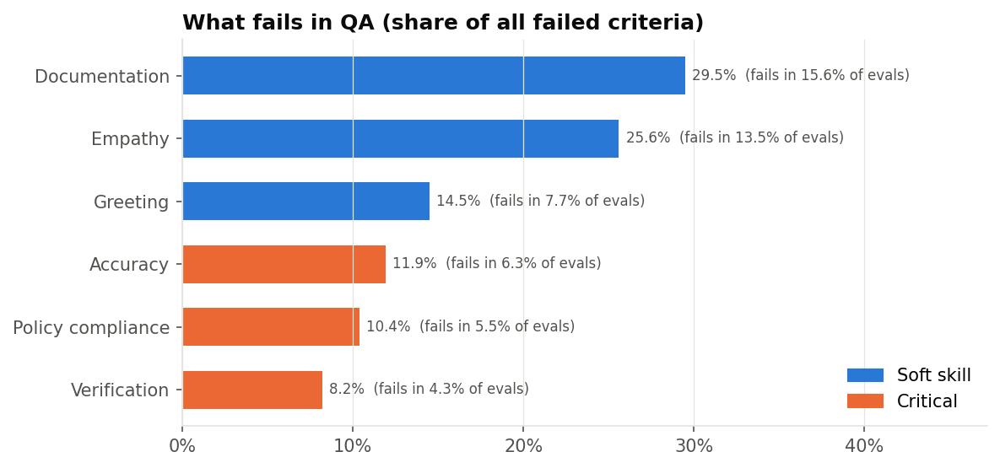
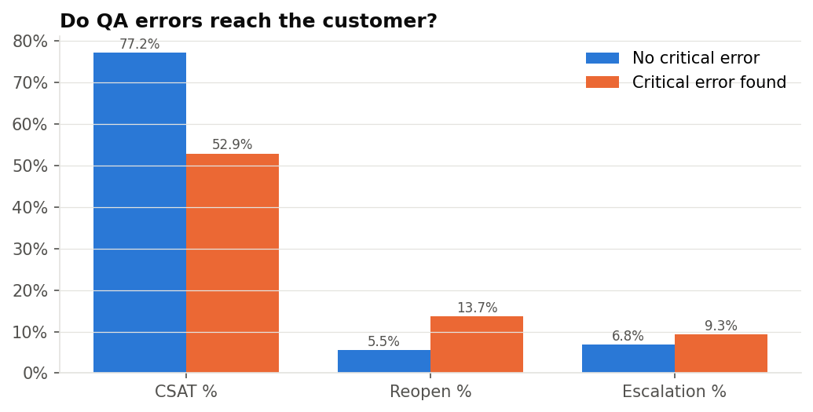
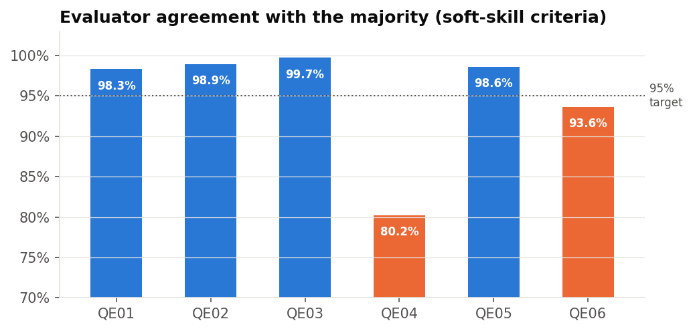

# Support Quality Analytics: QA, SLA & CSAT

Analytics for a customer-support operation (80 agents, 63,180 tickets, 7,304 QA evaluations over 12 months). It answers the questions a support or quality manager actually asks:

- Are we meeting SLA, and when do we miss it?
- Which QA criteria fail most, and which agents are most at risk?
- Do QA errors actually hurt customers?
- Are the QA evaluators scoring consistently?
- Did the coaching programme work?
- Who needs coaching next?

**Live dashboard:** https://nabeel1199.github.io/support-quality-analytics/

> **This project uses synthetic data.** Real contact-centre data (tickets, customer messages, agent scores) is confidential, so every row here is generated by [`scripts/generate_data.py`](scripts/generate_data.py) with a fixed random seed. It is not taken from, or based on, any real company's data. The generator builds in realistic patterns and some deliberately dirty data, and the analysis has to find them. The **methods** (SQL, checks, calibration, difference-in-differences) are what this project demonstrates, and they work unchanged on real data.



## Key findings

| Question | Finding |
|---|---|
| SLA | 89.3% of tickets were resolved within SLA. Attainment falls to **83.0% in the Dec peak** and **83.6% on Mondays**, the busiest day, compared with 98.6% on Saturdays. Misses follow volume, so this is a staffing issue, not an agent-quality issue. |
| What fails in QA | **70% of failed criteria are soft skills** (documentation 29.5%, empathy 25.6%, greeting 14.5%). Accuracy is the most common critical error (fails in 6.3% of evaluations). |
| Who fails | Agents in their **first 3 months** have a **21.2%** auto-fail rate, vs **14.3%** for agents with 6+ months. |
| Customer impact | Tickets with a critical error are **2.5x as likely to be reopened** (13.7% vs 5.5%), and CSAT drops from **77.2% to 52.9%**. An accuracy error alone takes CSAT from 76.6% to **23.1%**. Verification errors don't affect CSAT at all. Customers can't see them, which is why QA has to. |
| Calibration | **QE04** agrees with the majority on only **80.2%** of soft-skill judgements and scores agents **4 points lower** in live QA. **QE06** is lenient (misses errors, 93.6%). |
| Coaching | Team C's auto-fail rate fell 13.6% → 11.5%, while other teams rose 14.2% → 14.9%. **Difference-in-differences: −2.8 pts auto-fail, +2.0 pts QA score.** The gap is largest in Q3 2026 (8.8% vs 15.9%). |
| Next to coach | 7 agents fall in the bottom 10% of QA scores for Jul–Sep 2026 (each with 26+ evaluations). 3 of them are on Team B. |





## Recommendations

1. **Staff for Mondays and the Nov–Dec peak.** That is where SLA is lost.
2. **Target QA sampling and refreshers at accuracy, and at agents in their first 3 months.**
3. **Recalibrate QE04 and QE06** before their scores are used in performance reviews.
4. **Roll out the Team C coaching programme**, starting with the teams of the flagged agents.
5. **Fix data capture:** missing channels, invalid survey values and impossible timestamps.

## How the analysis works

| Step | File | What it does |
|---|---|---|
| Clean | `sql/01_clean.sql` | Measures and fixes 5 data issues: duplicate rows (316), resolved-before-created timestamps (40), out-of-range CSAT (60), unknown agent IDs (25), missing channel (632). Scores QA evaluations with a weighted rubric (`UNPIVOT` to long format). |
| Operations | `sql/02_operations.sql` | SLA by priority target, resolution time (median, p90), CSAT %, escalation and reopen rates by month, channel, category and weekday. |
| Quality | `sql/03_quality.sql` | Error Pareto, tenure analysis, and a join from QA results to ticket outcomes to test whether QA errors affect customers. |
| Calibration | `sql/04_calibration.sql` | Majority-vote consensus from monthly calibration sessions, agreement % per evaluator, and the direction of disagreement (stricter vs more lenient). |
| Coaching | `sql/05_coaching_and_scorecard.sql` | **Difference-in-differences**: Team C's change vs other teams over the same period, using established agents only so new hires don't distort it. Also a quarterly agent scorecard with a minimum-sample rule (12+ evaluations). |

**QA scoring:** 6 criteria with weights: greeting 10, verification 20, accuracy 25, policy compliance 20, empathy 10, documentation 15. Score = % of points passed. A failed **critical** criterion (verification, accuracy, policy) is counted as an **auto-fail**.

## Project structure

```
├── scripts/generate_data.py      # synthetic data generator (seeded)
├── scripts/make_notebook.py      # builds + executes the notebook
├── sql/                          # all analysis logic (5 files, run in order)
├── src/pipeline.py               # runs the SQL, exports results to exports/*.csv
├── src/charts.py                 # README figures
├── src/build_dashboard.py        # docs/index.html (GitHub Pages)
├── notebooks/analysis.ipynb
├── exports/                      # result tables (also for Tableau)
└── TABLEAU_GUIDE.md
```

## How to run

```bash
python3 -m venv .venv && source .venv/bin/activate
pip install -r requirements.txt
python scripts/generate_data.py
python src/pipeline.py
python src/charts.py
python src/build_dashboard.py
python scripts/make_notebook.py
```

## SQL techniques used

`UNPIVOT` (wide rubric → long format) · window functions (`row_number` for de-duplication, `rank`, `sum() OVER ()` for shares) · `QUALIFY` · `FILTER` aggregates · percentiles (`median`, `quantile_cont`) · majority-vote consensus · difference-in-differences · joins across tickets, agents, QA and calibration tables.

## Licence

Code and synthetic data: MIT. See [LICENSE](LICENSE).
